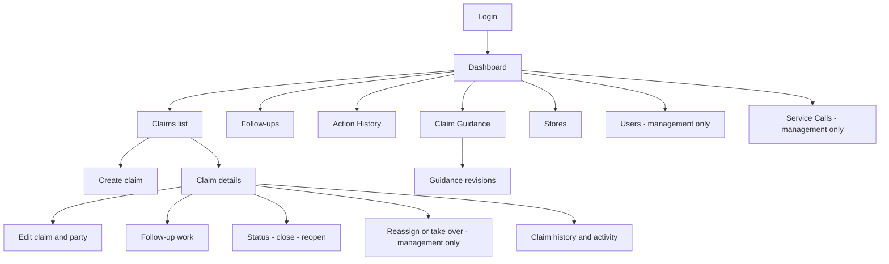
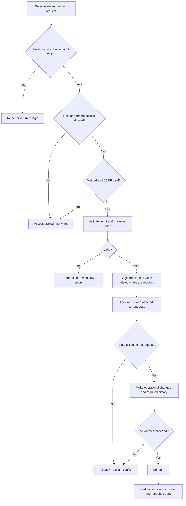
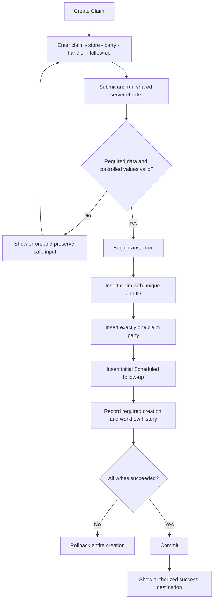
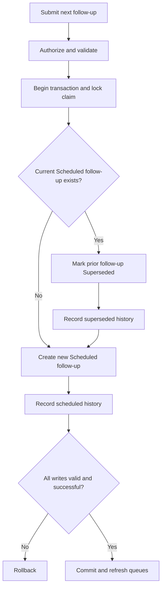
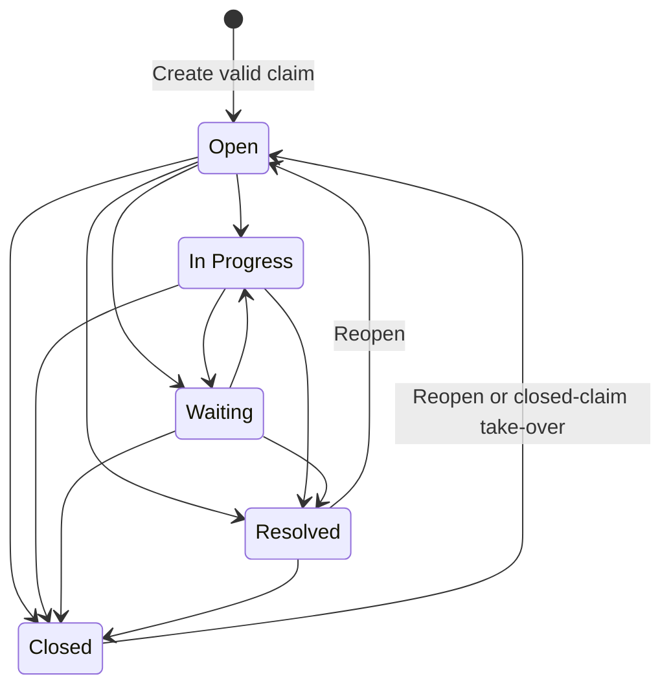
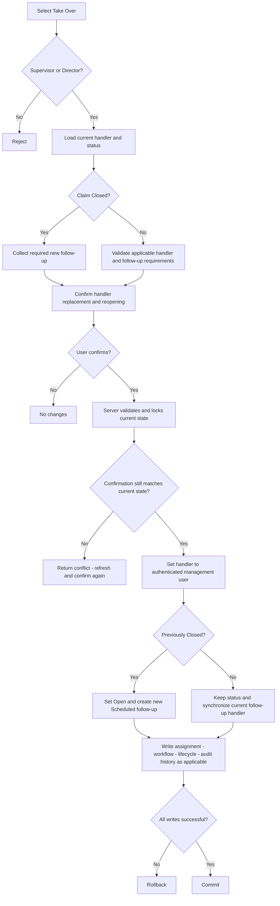
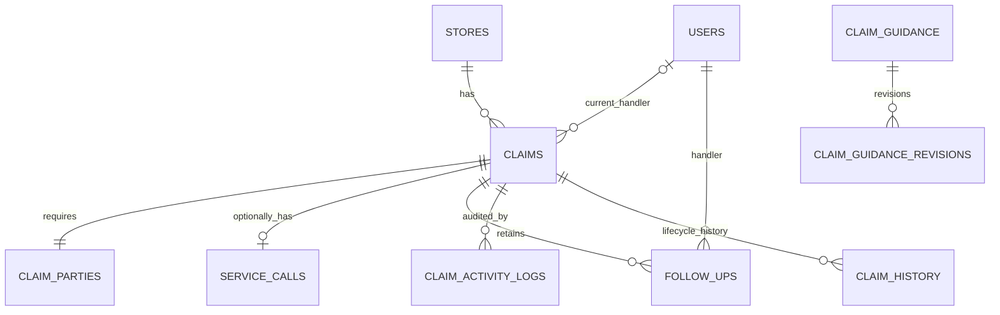

# QuickContractors Claims Tracker System — App Flow V1.1

**Document version:** 1.1  
**Application release:** V1.0  
**Status:** Revised draft for user review; not an implementation or testing approval  
**Prepared:** October 29, 2026  
**Supersedes:** App Flow V1.0 for reconciliation review  
**Controlling reference:** Claims_Tracker_System_Document_Reconciliation_Decision_Record_V1.1.md  
**Implementation baseline:** Not started; no database exists yet.

## 1. Purpose and authority

This document describes screens, navigation, user journeys, decisions, transactions, history writes, and failure paths for the internal QuickContractors Claims Tracker System. It expands the approved reconciliation decisions into an implementation-oriented flow reference without creating PHP, SQL, routes, or an application directory structure.

The approved V1.1 Decision Record controls conflicts. Existing approved architecture must be preserved. Exact physical columns and foreign keys must be finalized in the reconciled Database Schema Design Document, not inferred from this App Flow. Proposed technical safeguards and unresolved product details are identified explicitly below.

Source references such as “DR §6.5” refer to sections of the V1.1 Decision Record. Requirements tables and flows inherit those references; they are not independent feature approvals.

## 2. System and scope

### 2.1 Purpose

The application tracks claims involving third-party contractors and QuickContractors E-tech technicians. Daily work begins with overdue follow-ups, then due-today and upcoming work. Ownership, next actions, claim progress, and history must remain clear to authorized users. [DR §§2, 4]

### 2.2 Approved stack

| Layer | Technology |
|---|---|
| Backend | Procedural PHP |
| Database access | MySQLi with prepared statements |
| Storage | MySQL-compatible database, InnoDB |
| Frontend | HTML, CSS, Vanilla JavaScript, Bootstrap 5.3 |
| Icons | Font Awesome 6 |
| Confirmations | SweetAlert2 |
| Hosting | InfinityFree |

No Laravel, PDO, or other backend framework. Attachments, file uploads, Excel import, email reminders, notifications, and external integrations are excluded. No screens, buttons, upload fields, or diagrams may imply these features exist. [DR §3]

## 3. Roles and navigation

### 3.1 Identity and visibility

Each user has one role stored directly on the user record. Separate `roles` and `user_roles` tables are not required. [DR §§6.1–6.3]

| Stored role | Display label | Claim visibility |
|---|---|---|
| `Claim_Adjuster` | Claim Adjuster | Only claims currently assigned to that user |
| `Supervisor` | Supervisor | All claims |
| `Director` | Director | All claims |

All three roles may create claims, update permitted claim details, change status and priority, schedule/update/complete follow-ups, and record actions within their authorized scope. Only Supervisor and Director may reassign or take over claims. [DR §§6.4–6.6]

### 3.2 Sidebar order

| Order | Menu | Claim Adjuster | Supervisor | Director |
|---|---|---|---|---|
| 1 | Dashboard | Yes | Yes | Yes |
| 2 | Claims | Yes | Yes | Yes |
| 3 | Follow-ups | Yes | Yes | Yes |
| 4 | Action History | Yes | Yes | Yes |
| 5 | Claim Guidance | Yes | Yes | Yes |
| 6 | Users | No | Yes | Yes |
| 7 | Stores | View only | Yes | Yes |
| 8 | Service Calls | No | Yes | Yes |

Menu visibility follows DR §§8.1–8.2. A hidden menu is not authorization: direct requests must pass the same server checks. Service-call access must not become available to a Claim Adjuster simply by linking from a claim detail screen.

### 3.3 Screen map

These are screen responsibilities, not approved filenames or URL paths.

## 4. Shared request and security flow

### 4.1 Read requests

1. Load the authenticated session and validate the account is active.
2. Load the role from trusted server-side account data.
3. Check permission for the requested module.
4. Apply claim visibility to the database query.
5. Validate identifiers, filters, sorting, and pagination.
6. Retrieve only authorized records using MySQLi prepared statements for supplied values.
7. Escape output for its rendering context.
8. Return data, a true empty state, a safe access/not-found response, or a safe system error.

### 4.2 State-changing requests

Server-side authorization, validation, history recording, and transactions are mandatory under DR §10. POST, CSRF validation, safe output escaping, session protection, and duplicate-submission safeguards are technical safeguards carried forward from App Flow V1.0; their exact implementation belongs in the TRD.

A confirmation dialog is user feedback, not server authorization. Never keep a database transaction open while waiting for a user to respond to a dialog.

## 5. Authentication journey

### 5.1 Login

1. The user opens the application and sees Login if unauthenticated.
2. The user submits credentials.
3. The server validates input and verifies the stored password hash.
4. Invalid credentials or inactive accounts receive a safe login failure without an authenticated session.
5. On success, regenerate the session identifier, load identity and the single role, and open Dashboard.
6. Subsequent protected requests recheck account and authorization state.

### 5.2 Logout and expired session

Logout invalidates authenticated session state. An expired or invalid session prevents further protected reads and writes. A form submitted after session expiry must not save data or partially create history; return a safe session-expired response and require login again.

## 6. Dashboard and daily work

### 6.1 Required metrics

The dashboard displays these labels exactly. [DR §§8.3–8.5]

| Metric | Rule |
|---|---|
| Open Claims | Required metric; the exact count definition needs confirmation as described in §18 |
| Overdue Follow-ups | Current `Scheduled` follow-ups due before today's Philippine date |
| Due Today | Current `Scheduled` follow-ups due on today's Philippine date |
| Upcoming Follow-ups | Current `Scheduled` follow-ups due after today and through today plus 7 days |
| Claims Requiring Attention | Distinct claims with an overdue follow-up OR priority `Urgent` or `Escalated` |

Apply role scope before calculating totals. Count each claim once in Claims Requiring Attention even if both conditions apply. Do not silently exclude Resolved or Closed claims with urgent/escalated priority: the approved attention rule contains no such exclusion.

### 6.2 Daily journey

1. Open Dashboard.
2. Review Overdue Follow-ups first.
3. Select an entry; the server rechecks claim access.
4. Open claim detail with current handler, status, priority, party, and next action.
5. Perform authorized follow-up work or a claim update.
6. Save required next-action data and history.
7. Refresh Dashboard and affected queue counts from committed records.
8. Continue to Due Today, then Upcoming.

An empty queue shows a specific message such as “No follow-ups are currently overdue.” A database failure must show an error rather than zero counts or a misleading empty queue.

## 7. Create a claim

### 7.1 Required form data

| Data | Validation |
|---|---|
| `job_id` | Required and unique business claim identifier |
| Store | Exactly one required store |
| Claim type | `Leak`, `Damage`, or `Outdoor Damage` |
| Party type | `Third_Party_Contractor` or `E_Tech` |
| `contractor_email_address` | Required, validated email |
| `legal_company_name` | Required |
| `company_name` | Required |
| Assigned handler | Required valid user |
| Initial follow-up | Required current scheduled follow-up with date-only due date |
| Priority | Required; defaults to `Normal` |
| Status | New claim defaults to `Open` |

Requirements come from DR §§4.3–4.11 and §7. A service call is optional and must not become a condition of claim creation.

### 7.2 Creation transaction

The database unique constraint must reject duplicate Job IDs even if two requests pass a pre-check. If any required party, follow-up, or history write fails, do not retain a partial claim.

For a Claim Adjuster, creation-time assignment choices are not fully specified in V1.1. Do not infer that permission to create allows assignment to another user; resolve §18 before implementing that control.

## 8. Find, view, and edit claims

### 8.1 Claims list

Display the following columns in order: [DR §8.6]

1. Job ID
2. Store
3. Claim Type
4. Party Type
5. Assigned Handler
6. Claim Status
7. Priority
8. Next Follow-up Date
9. Last Follow-up Date
10. Follow-up Status
11. Actions

### 8.2 Search and filtering

Support Job ID search; status; priority; assigned handler limited to Claim Adjusters; follow-up state (`Overdue`, `Due Today`, `Upcoming`); store; party type; and follow-up-due-date range. Use 25 records per page. [DR §§8.7–8.8]

The assigned-handler filter is not an authorization override. For a Claim Adjuster, every query must still restrict results to that user's assigned claims. Confirm the wording/option-list interpretation in §18 before finalizing the control.

Validate filters before querying. Combine active filters with the authorized record scope. Preserve filters while paging, allow clearing them, and distinguish “No matching claims” from query failure.

### 8.3 Claim detail

Show approved claim fields, store, party, assigned handler, status, priority, current follow-up, and historical information. Expose only authorized actions. A direct request for an unauthorized claim must not reveal its details, history, or existence unnecessarily.

### 8.4 Edit claim and party

1. Load the authorized claim and current values.
2. Display permitted fields; do not expose assignment-changing controls to Claim Adjusters.
3. Validate submitted controlled values and required party fields.
4. Recheck authorization and current state at save time.
5. Update the existing one-to-one claim-party record instead of creating a second party row.
6. Record material changes in `claim_activity_logs`; use `claim_history` for lifecycle/major status transitions.
7. Commit changes and required history together.

A party may change after creation, but the old party information must remain traceable through the relevant history/activity record. [DR §§4.10, 5]

## 9. Follow-up workflows

### 9.1 Current versus historical follow-ups

Use `follow_ups`, not `actions`. One claim may have many historical follow-ups but at most one current scheduled follow-up. The current follow-up follows the current claim handler; historical follow-ups retain their original handler. [DR §4.11]

Approved status labels are `Scheduled`, `Overdue`, `Completed`, `Cancelled`, and `Superseded`. For queue calculations, V1.1 explicitly defines Overdue as a derived state of a row whose stored status remains `Scheduled`; do not require a nightly update to persist `Overdue` before a claim appears in the queue. Any physical use of a stored `Overdue` value needs a reconciled schema rule before implementation.

### 9.2 Schedule or replace

1. Open an authorized claim's Follow-up area.
2. Enter due date only; do not request a follow-up time.
3. Enter follow-up details supported by the final schema.
4. Validate claim state, handler, request, and due date.
5. Begin transaction; lock the parent claim and reload its current follow-up.
6. If a current scheduled follow-up exists, mark it `Superseded`, retaining its prior details and original handler.
7. Record the superseding event in `action_history`.
8. Create the new `Scheduled` follow-up for the current handler.
9. Record the scheduling event.
10. Commit all changes together; refresh claim and queues.

Parent locking is a proposed technical concurrency safeguard, not a new table or product feature. Every follow-up writer must follow the same lock order; final enforcement belongs in the TRD/schema review.

### 9.3 Update an existing follow-up

V1.1 allows follow-up updates. Load and verify the current record, validate new data, preserve prior material details in the approved history mechanism, and save transactionally. Whether a due-date change is an in-place update with history or always a replacement must be confirmed; do not silently erase scheduling history.

### 9.4 Complete a follow-up

1. Open the authorized current follow-up.
2. Submit the completion information required by the final form/schema.
3. Lock and reload the claim and follow-up.
4. Confirm it has not already been completed, cancelled, superseded, or replaced.
5. Mark it `Completed`; preserve handler and prior due date.
6. Record completion in `action_history`.
7. Apply the approved next-action invariant before committing if the claim remains active.
8. Commit, show success, and refresh the queue.

**Proposed implementation safeguard requiring confirmation:** when an active claim must retain a dated next action, collect a replacement follow-up or valid terminal status change in the same operation. Do not commit an unexplained active claim without a next action merely because the UI intends to prompt afterward.

### 9.5 Cancel a follow-up

Show a SweetAlert2 cancellation confirmation. On confirmation, validate authorization and current state, mark the target `Cancelled`, and record cancellation in `action_history` within the transaction. Keep the record and its original handler. If cancellation would leave an active claim without its required next action, apply a confirmed replacement/terminal-state rule before saving.

Dismissing the confirmation performs no writes. A stale or repeated cancellation request must not create duplicate cancellation effects.

## 10. Status and priority workflows

### 10.1 Exact transition matrix

| From | Allowed destinations |
|---|---|
| Open | In Progress; Waiting; Resolved; Closed |
| In Progress | Waiting; Resolved; Closed |
| Waiting | In Progress; Resolved; Closed |
| Resolved | Closed; Open |
| Closed | Open |

No other status transition is approved. [DR §§4.5–4.6]

The diagram uses `Open`, not the old conceptual `New` or `Active` status. Do not add a lifecycle transition simply to simplify a UI button.

### 10.2 Save status or priority

Authorize against the current claim, validate controlled values and transition, lock/reload current state, apply required follow-up effects, write audit/lifecycle history, and commit together.

Approved priorities: `Non-Urgent`, `Low`, `Normal`, `High`, `Urgent`, `Escalated`. Priority changes do not change status. Recalculate Claims Requiring Attention after committed priority changes. [DR §§4.7, 5, 8.4]

### 10.3 Resolve

A transition to `Resolved` must follow the matrix. V1.1 explicitly requires cancellation when closing, but does not specify the follow-up disposition on resolution. Do not assume `Resolved` automatically cancels or completes a follow-up; resolve §18 before implementing that side effect.

## 11. Close and reopen

### 11.1 Close

All three roles may close within claim scope; a Claim Adjuster may close only their assigned claims. [DR §6.6]

1. Select Close Claim.
2. Show SweetAlert2 confirmation explaining that current scheduled follow-up work will be cancelled and history retained.
3. On confirmation, run shared server checks.
4. Lock/reload claim and current follow-up; validate transition to `Closed`.
5. Set claim status to `Closed`.
6. Cancel any current scheduled follow-up and record cancellation.
7. Record `claim closed` workflow action, lifecycle transition, and relevant audit event.
8. Commit all related writes together.
9. Display Closed claim and updated queues.

### 11.2 Reopen

All three roles may reopen `Resolved` or `Closed` within scope. A Claim Adjuster may reopen only assigned claims. Destination is `Open`. [DR §§4.6, 6.6]

1. Select Reopen Claim.
2. Load current handler and existing current follow-up, if any.
3. Require a handler or dated follow-up where missing.
4. Show SweetAlert2 confirmation with the consequences.
5. On submission, recheck permission, status, handler, and follow-up requirements.
6. Lock/reload current state and set status to `Open`.
7. Create required scheduled follow-up if missing, preserving prior cancelled/completed records.
8. Record reopened workflow action, lifecycle transition, and audit event.
9. Commit only a valid reopened claim.

Cancelling a dialog or failing validation leaves the claim and history unchanged.

## 12. Reassignment and take-over

### 12.1 Reassign

Only Supervisor and Director may reassign. [DR §6.5]

1. Load claim and current handler.
2. Select the replacement handler using approved assignment eligibility rules.
3. Show SweetAlert2 confirmation identifying the handler change.
4. Validate and lock/reload current state on submission.
5. Update current claim ownership.
6. Move the current follow-up's responsibility to the new handler, without rewriting handlers on historical follow-ups.
7. Record assignment history and a material assignment audit event.
8. Commit together and refresh claim visibility and workload.

A formerly assigned Claim Adjuster must lose access after successful reassignment. Reassignment alone does not imply a status change; automatic reopening is explicitly required for Closed-claim take-over, not ordinary reassignment.

### 12.2 Take over

A Supervisor or Director may take over an unassigned claim or another user's claim in any status, including `Resolved` and `Closed`. The new handler is the authenticated management user, not a client-supplied identity. [DR §6.5]

The warning must identify the current handler, or state that there is none, and explicitly say that the handler will be replaced. For a Closed claim it must also explain automatic reopening and the required new follow-up. A Resolved-claim take-over does not automatically reopen it: V1.1 mandates this side effect only for Closed claims.

Assignment history must preserve previous handler, new handler, actor, operation, and time according to the final schema. V1.1 requires assignment history but does not mandate a separate assignment-history table.

## 13. Supporting modules

### 13.1 Stores

All roles may open Stores; Claim Adjusters are view-only. Management modification controls must enforce server permissions. Each claim retains exactly one store; one store can have many claims. Deactivate rather than delete referenced stores. [DR §§4.8, 8.2]

For deactivation, select store, show SweetAlert2 confirmation, validate permission/reference policy, deactivate, and retain existing claim links. New-claim selection behavior for inactive stores must be finalized in the schema/product review.

### 13.2 Service calls

Only Supervisor and Director may open Service Calls. Select an authorized claim, load an existing service call or create its optional record, validate the fields, and save. [DR §§4.9, 8.2]

Enforce zero-or-one service call per claim. `sc_job_id` may be null; populated values must be unique. Normalize an absent identifier consistently so an empty string does not accidentally behave like a shared job identifier. Reject a second service-call record and duplicate populated identifier without partial writes.

### 13.3 Users

| Actor | Permitted target accounts |
|---|---|
| Claim Adjuster | No user management |
| Supervisor | Claim Adjuster accounts only |
| Director | Claim Adjuster, Supervisor, and Director accounts |

On create/edit/deactivate, check both the actor's role and the target account's current and requested role. A Supervisor must not promote an adjuster to Supervisor or modify a Director by submitting a forged account identifier. [DR §6.7]

User accounts are deactivated, not deleted. No account-deletion flow exists, including self-deletion. Deactivation uses SweetAlert2 confirmation. Reassignment obligations for outstanding work, self-deactivation, and last-Director protection require explicit product decisions before implementing such restrictions or side effects.

### 13.4 Claim guidance

| Actor | View | Create/edit | Approve | Deactivate |
|---|---|---|---|---|
| Claim Adjuster | Yes | No | No | No |
| Supervisor | Yes | Yes | No | No |
| Director | Yes | Yes | Yes | Yes |

Guidance statuses are `Draft`, `Approved`, and `Inactive`. Every edit creates a revision; previous revisions remain viewable and cannot be deleted through the application. [DR §§6.8–6.9]

Flow: open Claim Guidance, choose a permitted record, view content/revisions, select an authorized change, validate, write current content and a new revision atomically, and refresh. Director approval and deactivation require server-side role checks; deactivation additionally requires SweetAlert2 confirmation.

V1.1 does not define every allowed guidance status transition, whether edits to approved content reset approval, or which statuses each role can view. Do not invent those publication rules.

## 14. History and audit journeys

| Data area | Responsibility | Navigation outcome |
|---|---|---|
| `follow_ups` | Current and historical follow-up records | Review prior due dates, handlers, outcomes, and terminal states |
| `action_history` | Scheduled/completed/cancelled/superseded follow-ups; claim closed/reopened | Review workflow actions |
| `claim_activity_logs` | Material status, priority, assignment, and field changes | Review change audit |
| `claim_history` | Claim lifecycle and major status transitions | Review lifecycle chronology |
| Assignment history | Every reassignment and take-over | Review ownership changes using approved storage mapping |
| Guidance revisions | Every guidance edit | Review prior guidance versions |

Responsibilities follow DR §§5, 6.5, 6.8. An event may legitimately require more than one history responsibility, such as closure workflow plus lifecycle transition. Do not combine all records into one indistinguishable log or silently discard required records.

History access must inherit the associated claim's current authorization scope. Old authorship or a former assignment must not automatically grant a Claim Adjuster access after reassignment. History screens are read-only through normal application actions.

## 15. Date and queue behavior

### 15.1 Storage and display

Follow-up due dates are `DATE`-like calendar values without a user-entered time. V1.1 states UTC date/timestamp storage, with `Asia/Manila` display and current-date calculation. A date-only due value must not be shifted to the previous day by treating it as midnight Manila and converting it as a timestamp. Finalize the physical date convention in the schema; preserve the user's intended calendar due date. [DR §§4.11–4.12, 8.8]

True event timestamps use UTC and convert to `Asia/Manila` for display. Dates display `MM/DD/YYYY`; timestamps display `MM/DD/YYYY hh:mm AM/PM`.

### 15.2 Classification

Let T be today's Philippine calendar date. Evaluate the current `Scheduled` follow-up:

| Due date | Queue |
|---|---|
| Before T | Overdue |
| Equal to T | Due Today |
| T + 1 through T + 7 inclusive | Upcoming |
| After T + 7 | Still scheduled; outside these three queues |
| Completed, Cancelled, Superseded | No pending queue |

Use one consistent T for counts and rows in a request. Do not use the hosting server's unverified local date. No notification subsystem or cron process is needed merely to calculate queue membership. Never label Upcoming as “Due soon.”

## 16. Reconciled data-model diagram

### 16.1 Eleven-table reconciliation candidate

The old App Flow names ten tables, including `actions`, `claim_guidance`, and `claim_guidance_revisions`. Replacing `actions` with `follow_ups` and adding the required `claim_parties` yields the following eleven-table reconciliation candidate:

1. `users`
2. `stores`
3. `claims`
4. `claim_parties`
5. `service_calls`
6. `follow_ups`
7. `action_history`
8. `claim_activity_logs`
9. `claim_history`
10. `claim_guidance`
11. `claim_guidance_revisions`

**Approval boundary:** this is a source-grounded reconciliation candidate, not proof that V1.1 enumerates these exact eleven names or approves their physical columns. Confirm the list in the Database Schema Design Document before SQL. Claim types and statuses can be controlled values; V1.1 does not require separate lookup tables for them.

This corrects the previous generated documents' unsupported suggestion that guidance must be removed or somehow squeezed into other records because separate type/status tables are mandatory. Those earlier schema/TRD drafts need correction before implementation; this App Flow does not automatically edit them.

### 16.2 Conceptual relationships

The relationship diagram shows ten of the eleven candidate tables; `action_history` is represented separately by the responsibility map in §14. Its exact claim/follow-up linkage must be reconciled in the schema: V1.1 defines responsibility, not a mandatory direct `claim_id` column. Do not reintroduce a previously removed redundant foreign key without review.

The diagram deliberately does not invent an assignment-history table, claim-to-guidance relationship, or physical action-history foreign-key topology. Cardinality alone does not enforce required child existence: creation transactions and the finalized integrity strategy must prevent claims without their required party.

## 17. Confirmations and failure behavior

### 17.1 Required SweetAlert2 dialogs

| Operation | Required consequence to explain |
|---|---|
| Take over claim | Current handler replaced; Closed claim reopens and needs a new follow-up |
| Reassign claim | Current handler changes to selected handler |
| Close claim | Claim closes; current scheduled follow-up cancelled |
| Reopen claim | Claim returns to Open; missing handler/follow-up must be supplied |
| Cancel follow-up | Follow-up removed from pending work but history retained |
| Deactivate user | Account becomes inactive; no account deletion |
| Deactivate store | Store becomes inactive; existing claim links retained |
| Deactivate guidance | Guidance becomes Inactive; revisions retained |

These required dialogs originate in DR §8.9. Details must reflect the current server state. If the handler or status changes after the preview, return a conflict and request a refreshed confirmation rather than silently applying different consequences.

### 17.2 Failure outcomes

| Condition | Required outcome |
|---|---|
| Unauthenticated/expired session | No protected data or writes; require login |
| Unauthorized role or claim | Safe rejection; no record disclosure or partial changes |
| Invalid field/controlled value | Specific safe validation error; retain appropriate form input |
| Duplicate Job ID/service-call identifier | Safe duplicate error; enforce database uniqueness |
| Follow-up replaced during editing | Conflict response; reload current work |
| History insertion fails | Roll back related operational writes |
| Database failure | Roll back, log technical details safely, show non-technical error |
| Confirmation cancelled | No state change |
| Repeated submission | No duplicate transition, workflow action, or replacement follow-up |

Do not expose credentials, raw SQL errors, stack traces, internal paths, passwords, tokens, or unnecessary claim data in error output or logs.

## 18. Decisions before implementation

These are genuine unspecified details, not permission to change the approved requirements:

| Item | Confirmation needed | Affected flow |
|---|---|---|
| Exact 11-table inventory and columns | Approve the candidate in §16 and reconcile earlier generated schema/TRD | Database setup |
| Assignment-history storage | Map required previous/new handler, actor, time, and operation to approved storage | Reassign/take-over |
| Open Claims metric | Status exactly Open, or all active statuses? | Dashboard count |
| Last Follow-up Date | Last due date, completion date, or another documented date? | Claims list |
| Assigned-handler filter wording | Confirm option list and role visibility; never broaden record authorization | Claims search |
| Initial assignment | Define Claim Adjuster assignment choices and eligible handler roles | New claim |
| Follow-up update semantics | In-place audited edit versus replacement/superseding | Update follow-up |
| Active claim completion/cancellation | Confirm atomic replacement or terminal-state behavior | Follow-up completion/cancellation |
| Resolution side effects | Whether a current follow-up is retained/cancelled on Resolved | Resolve |
| Guidance publication | Status transitions, visibility by status, and approval after edits | Guidance |
| Account deactivation | Outstanding-work handling, self-deactivation, last-Director protection | Users |
| Date-only convention | Preserve intended calendar due date alongside UTC timestamps | Date handling |

Pause only the affected implementation until a decision is recorded. Do not describe the whole application as implemented, tested, or approved for production.

## 19. Acceptance scenarios

| ID | Scenario | Expected result |
|---|---|---|
| AF-01 | Claim Adjuster opens another user's claim directly | Access denied; no claim or history disclosure |
| AF-02 | Create valid claim | Open/Normal defaults, required party/store/handler/follow-up saved together |
| AF-03 | Party insert fails during creation | Entire claim creation rolled back |
| AF-04 | Two submissions use same Job ID | Only one claim saved |
| AF-05 | New follow-up replaces current one | Old Superseded; new sole Scheduled record; history retained |
| AF-06 | Two requests replace same follow-up concurrently | At most one current follow-up; no lost history |
| AF-07 | Due yesterday, today, +7 days, +8 days | Overdue, Due Today, Upcoming, outside Upcoming respectively |
| AF-08 | Cancel confirmation dismissed | No writes |
| AF-09 | Close assigned claim | Closed; current scheduled follow-up Cancelled; required history committed |
| AF-10 | Reopen without required missing data | Validation failure; no partially reopened claim |
| AF-11 | Claim Adjuster submits reassignment | Rejected |
| AF-12 | Director takes over Closed claim | Handler replaced, Open status, new dated follow-up, assignment/lifecycle/workflow history |
| AF-13 | Supervisor takes over Resolved claim | Ownership changes; no automatic reopening inferred |
| AF-14 | Reassign claim | Current follow-up follows new handler; historical handlers unchanged |
| AF-15 | Supervisor attempts Director-account edit | Rejected |
| AF-16 | Claim Adjuster opens Service Calls endpoint | Rejected |
| AF-17 | Add second service call or duplicate populated sc_job_id | Rejected safely |
| AF-18 | Supervisor edits guidance | New revision retained; no approve/deactivate privilege |
| AF-19 | Claim meets both attention conditions | Counted once |
| AF-20 | List has more than 25 authorized matches | 25 per page; filters and access scope preserved |
| AF-21 | History write fails on closure | Operational closure and cancellation rolled back |
| AF-22 | Follow-up crosses Philippine midnight | Counts and queue use Philippine date, not server local time |

These are test specifications, not executed test results.

## 20. Implementation handoff

1. Review this revised App Flow against the approved Decision Record.
2. Resolve the affected open decisions and correct the earlier schema/TRD table-inventory error.
3. Approve the physical schema and preserve the existing approved project structure.
4. Inspect actual project files before proposing any code change.
5. Explain the smallest necessary change and obtain approval before PHP/SQL implementation.
6. Implement shared security, then transactional workflows, then authorized views.
7. Execute and record acceptance tests; do not infer success from written code.

**Suggested documentation commit message:**

`docs: reconcile app flow with decision record v1.1`

**End of App Flow V1.1 — revised draft for review.**
