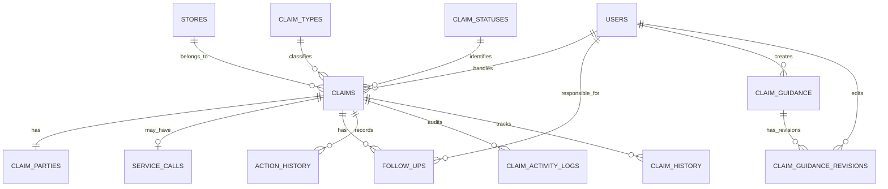

# Claims Tracker System

## Background Schema / Database Schema Design Document — Version 1.1

**Document status:** Approved for implementation  
**Version:** 1.1  
**Supersedes:** Database Schema Design Document Version 1.0  
**Date:** October 29, 2026  
**Authoritative reconciliation source:** `Claims_Tracker_System_Document_Reconciliation_Decision_Record_V1.1.md`  
**Implementation status:** Not started. No database exists yet.

---

## 1. Overview

### 1.1 Purpose

This document defines the approved V1.0 database structure for the QuickContractors Claims Tracker System.

It defines the approved tables, relationships, fields, constraints, indexes, history responsibilities, status values, role model, and data-integrity rules required before PHP implementation begins.

### 1.2 Technology Standards

| Component          | Requirement                                                           |
| ------------------ | --------------------------------------------------------------------- |
| Backend            | Procedural PHP                                                        |
| Database interface | MySQLi                                                                |
| Database engine    | MySQL-compatible database using InnoDB                                |
| Character encoding | `utf8mb4`                                                             |
| Database access    | Prepared statements for variable input                                |
| Transactions       | Required for related changes that must succeed or fail together       |
| Access control     | Server-side authorization for every protected operation               |
| Hosting target     | InfinityFree, subject to verification of current MySQL and PHP limits |
| Schema changes     | Version-controlled SQL installation or migration scripts              |

The implementation must not use Laravel or PDO.

### 1.3 Database Design Principles

1. Use primary keys, foreign keys, unique constraints, and appropriate `NOT NULL` rules.
2. Store controlled values consistently.
3. Preserve historical and audit records.
4. Use least-privilege database accounts.
5. Enforce authorization in PHP before protected database operations.
6. Use transactions for related updates.
7. Prefer deactivation over deletion for referenced users and stores.
8. Keep schema changes version-controlled and documented.

### 1.4 Scope Boundaries

The following are excluded from V1.0 and must not be implemented:

- Claim attachments.
- File uploads.
- `claim_attachments` table.
- Email reminders.
- Automated notifications.
- Excel import.
- External integrations.
- Separate `roles` and `user_roles` tables.
- The former `actions` table.

---

## 2. Approved 13-Table Model

The system must use the approved **13-table model**: the eleven original tables plus `claim_guidance` and `claim_guidance_revisions`.

|   # | Table                      | Purpose                                                                   |
| --: | -------------------------- | ------------------------------------------------------------------------- |
|   1 | `users`                    | System users, authentication data, one role per user, and account status. |
|   2 | `stores`                   | Store records associated with claims.                                     |
|   3 | `claims`                   | Main claim records and current claim state.                               |
|   4 | `claim_types`              | Approved claim-type lookup values.                                        |
|   5 | `claim_statuses`           | Approved claim lifecycle status lookup values.                            |
|   6 | `claim_parties`            | Required one-to-one claim-party information.                              |
|   7 | `service_calls`            | Optional zero-or-one service-call record per claim.                       |
|   8 | `follow_ups`               | Current and historical follow-up records.                                 |
|   9 | `action_history`           | Workflow-action history.                                                  |
|  10 | `claim_activity_logs`      | Audit events for material claim changes.                                  |
|  11 | `claim_history`            | Claim lifecycle and major status-transition history.                      |
|  12 | `claim_guidance`           | Claim guidance records with current content and guidance status.          |
|  13 | `claim_guidance_revisions` | Preserved revision for every guidance edit and status change.             |

### 2.1 Guidance Requirement

Guidance and its revision history are stored in `claim_guidance` and `claim_guidance_revisions` (tables 12 and 13), an approved addition to the original eleven tables. Their columns are defined in §4.12 and §4.13.

The implementation must not silently add further tables or unapproved fields.

---

## 3. Entity Relationships

### 3.1 Relationship Rules

| Relationship                                   | Cardinality        | Rule                                                                                  |
| ---------------------------------------------- | ------------------ | ------------------------------------------------------------------------------------- |
| `stores` to `claims`                           | One-to-many        | Every claim must have exactly one store.                                              |
| `claim_types` to `claims`                      | One-to-many        | Every claim must have one approved claim type.                                        |
| `claim_statuses` to `claims`                   | One-to-many        | Every claim must have one approved status.                                            |
| `users` to `claims`                            | One-to-many        | A user may be the assigned handler for many claims.                                   |
| `claims` to `claim_parties`                    | One-to-one         | Every claim must have exactly one claim party.                                        |
| `claims` to `service_calls`                    | One-to-zero-or-one | Each claim may have zero or one service call.                                         |
| `claims` to `follow_ups`                       | One-to-many        | A claim may have many historical follow-ups but only one current scheduled follow-up. |
| `users` to `follow_ups`                        | One-to-many        | A user may be responsible for many follow-ups.                                        |
| `claims` to `action_history`                   | One-to-many        | A claim may have many workflow-action records.                                        |
| `claims` to `claim_activity_logs`              | One-to-many        | A claim may have many audit records.                                                  |
| `claims` to `claim_history`                    | One-to-many        | A claim may have many lifecycle-history records.                                      |
| `claim_guidance` to `claim_guidance_revisions` | One-to-many        | A guidance record may have many revisions; revisions are preserved.                   |
| `users` to `claim_guidance`                    | One-to-many        | A user may create many guidance records.                                              |
| `users` to `claim_guidance_revisions`          | One-to-many        | A user may make many guidance edits or status changes.                                |

### 3.2 Entity Relationship Diagram

---

## 4. Table Specifications

### 4.1 `users`

**Purpose:** Stores system user accounts and each user’s single role.

| Column          | Proposed type                 | Requirement                                                          |
| --------------- | ----------------------------- | -------------------------------------------------------------------- |
| `id`            | `INT UNSIGNED AUTO_INCREMENT` | Primary key.                                                         |
| `username`      | `VARCHAR(100)`                | Required, unique login identifier.                                   |
| `password_hash` | `VARCHAR(255)`                | Required password hash; never store plaintext passwords.             |
| `full_name`     | `VARCHAR(150)`                | Required display name.                                               |
| `email`         | `VARCHAR(190)`                | Required or optional according to final account requirements.        |
| `role`          | `VARCHAR(50)`                 | Required; allowed values `Claim_Adjuster`, `Supervisor`, `Director`. |
| `is_active`     | `TINYINT(1)`                  | Required; `1` active, `0` deactivated.                               |
| `created_at`    | `DATETIME`                    | UTC creation timestamp.                                              |
| `updated_at`    | `DATETIME`                    | UTC last-update timestamp.                                           |

#### Rules

- Each user has exactly one role stored directly on the user record.
- Do not create `roles` or `user_roles` tables.
- Enforce uniqueness on `username`.
- Reject inactive accounts during authentication.
- Deactivate users rather than deleting them.
- A user cannot delete their own account.
- Never expose `password_hash` in normal application responses.

---

### 4.2 `stores`

**Purpose:** Stores store or business-location records associated with claims.

| Column       | Proposed type                 | Requirement                                             |
| ------------ | ----------------------------- | ------------------------------------------------------- |
| `id`         | `INT UNSIGNED AUTO_INCREMENT` | Primary key.                                            |
| `store_name` | `VARCHAR(150)`                | Required store name.                                    |
| `store_code` | `VARCHAR(50)`                 | Optional or required according to final business rules. |
| `address`    | `VARCHAR(255)`                | Optional store address.                                 |
| `is_active`  | `TINYINT(1)`                  | Required; `1` active, `0` deactivated.                  |
| `created_at` | `DATETIME`                    | UTC creation timestamp.                                 |
| `updated_at` | `DATETIME`                    | UTC last-update timestamp.                              |

#### Rules

- Every claim must link to exactly one store.
- A store may have many claims.
- Stores must be deactivated rather than deleted while claims reference them.
- Store deactivation requires confirmation and must be traceable.

---

### 4.3 `claims`

**Purpose:** Stores the main claim record and current claim state.

| Column                | Proposed type                 | Requirement                                                |
| --------------------- | ----------------------------- | ---------------------------------------------------------- |
| `id`                  | `INT UNSIGNED AUTO_INCREMENT` | Primary key.                                               |
| `job_id`              | `VARCHAR(100)`                | Required, unique business claim identifier.                |
| `store_id`            | `INT UNSIGNED`                | Required foreign key to `stores.id`.                       |
| `claim_type_id`       | `INT UNSIGNED`                | Required foreign key to `claim_types.id`.                  |
| `claim_status_id`     | `INT UNSIGNED`                | Required foreign key to `claim_statuses.id`.               |
| `assigned_handler_id` | `INT UNSIGNED`                | Required foreign key to `users.id` for active claims.      |
| `priority`            | `VARCHAR(30)`                 | Required approved priority value.                          |
| `subject`             | `VARCHAR(255)`                | Required or optional according to final form requirements. |
| `description`         | `TEXT`                        | Claim details, subject to data minimization.               |
| `created_at`          | `DATETIME`                    | UTC creation timestamp.                                    |
| `updated_at`          | `DATETIME`                    | UTC last-update timestamp.                                 |

#### Rules

- `job_id` must be unique.
- Every claim must have exactly one store.
- Every claim must have one approved claim type.
- Every claim must have one approved status.
- Every new claim must have an assigned handler.
- Active claims must have a current handler and dated follow-up.
- `Resolved` and `Closed` claims are exempt from the active-claim handler/action requirement.
- Approved priority values are `Non-Urgent`, `Low`, `Normal`, `High`, `Urgent`, and `Escalated`.
- Default status for a new claim is `Open`.
- Default priority for a new claim is `Normal`.

---

### 4.4 `claim_types`

**Purpose:** Controls approved claim categories.

| Column      | Proposed type                 | Requirement                                                |
| ----------- | ----------------------------- | ---------------------------------------------------------- |
| `id`        | `INT UNSIGNED AUTO_INCREMENT` | Primary key.                                               |
| `type_name` | `VARCHAR(50)`                 | Required, unique claim-type name.                          |
| `is_active` | `TINYINT(1)`                  | Indicates whether the type can be selected for new claims. |

#### Seed Values

1. `Leak`
2. `Damage`
3. `Outdoor Damage`

Claim types must be inserted through a controlled seed script, not created freely by users.

---

### 4.5 `claim_statuses`

**Purpose:** Controls approved claim lifecycle statuses.

| Column        | Proposed type                 | Requirement                                     |
| ------------- | ----------------------------- | ----------------------------------------------- |
| `id`          | `INT UNSIGNED AUTO_INCREMENT` | Primary key.                                    |
| `status_name` | `VARCHAR(50)`                 | Required, unique status name.                   |
| `description` | `VARCHAR(255)`                | Optional explanation.                           |
| `is_active`   | `TINYINT(1)`                  | Indicates whether the status remains available. |

#### Seed Values

1. `Open`
2. `In Progress`
3. `Waiting`
4. `Resolved`
5. `Closed`

A foreign key ensures that a status exists; PHP must enforce permitted transitions.

---

### 4.6 `claim_parties`

**Purpose:** Stores the required party information for each claim.

| Column                     | Proposed type                 | Requirement                                     |
| -------------------------- | ----------------------------- | ----------------------------------------------- |
| `id`                       | `INT UNSIGNED AUTO_INCREMENT` | Primary key.                                    |
| `claim_id`                 | `INT UNSIGNED`                | Required, unique foreign key to `claims.id`.    |
| `party_type`               | `VARCHAR(50)`                 | Required; `Third_Party_Contractor` or `E_Tech`. |
| `contractor_email_address` | `VARCHAR(190)`                | Required email address.                         |
| `legal_company_name`       | `VARCHAR(255)`                | Required legal company name.                    |
| `company_name`             | `VARCHAR(255)`                | Required company/display name.                  |
| `created_at`               | `DATETIME`                    | UTC creation timestamp.                         |
| `updated_at`               | `DATETIME`                    | UTC last-update timestamp.                      |

#### Rules

- Each claim must have exactly one claim-party record.
- Enforce one-to-one using a unique constraint on `claim_id`.
- `party_type` must be limited to approved values.
- The party record may be edited or changed after claim creation.
- Every claim-party change must be recorded in claim history or claim activity logs.
- Validate email format and required fields on the server.

---

### 4.7 `service_calls`

**Purpose:** Stores optional service-call details associated with a claim.

| Column                 | Proposed type                 | Requirement                                  |
| ---------------------- | ----------------------------- | -------------------------------------------- |
| `id`                   | `INT UNSIGNED AUTO_INCREMENT` | Primary key.                                 |
| `claim_id`             | `INT UNSIGNED`                | Required, unique foreign key to `claims.id`. |
| `sc_job_id`            | `VARCHAR(100)`                | Nullable service-call job identifier.        |
| `service_call_details` | `TEXT`                        | Optional service-call information.           |
| `created_at`           | `DATETIME`                    | UTC creation timestamp.                      |
| `updated_at`           | `DATETIME`                    | UTC last-update timestamp.                   |

#### Rules

- Each claim may have zero or one service-call record.
- Enforce one-to-one using a unique constraint on `claim_id`.
- `sc_job_id` is nullable.
- When populated, `sc_job_id` must be unique.
- Service Calls are accessible only to Supervisor and Director.

---

### 4.8 `follow_ups`

**Purpose:** Stores current and historical follow-up records.

| Column         | Proposed type                 | Requirement                                                                              |
| -------------- | ----------------------------- | ---------------------------------------------------------------------------------------- |
| `id`           | `INT UNSIGNED AUTO_INCREMENT` | Primary key.                                                                             |
| `claim_id`     | `INT UNSIGNED`                | Required foreign key to `claims.id`.                                                     |
| `handler_id`   | `INT UNSIGNED`                | Required foreign key to `users.id`; retains the original handler for historical records. |
| `due_date`     | `DATE`                        | Required date-only follow-up due date.                                                   |
| `status`       | `VARCHAR(30)`                 | Required approved follow-up status.                                                      |
| `details`      | `TEXT`                        | Follow-up instructions or notes.                                                         |
| `outcome`      | `TEXT`                        | Result or completion notes.                                                              |
| `completed_at` | `DATETIME`                    | Nullable UTC completion timestamp.                                                       |
| `created_at`   | `DATETIME`                    | UTC creation timestamp.                                                                  |
| `updated_at`   | `DATETIME`                    | UTC last-update timestamp.                                                               |

#### Approved Follow-Up Statuses

1. `Scheduled`
2. `Overdue`
3. `Completed`
4. `Cancelled`
5. `Superseded`

#### Rules

- A claim may have only one current scheduled follow-up at a time.
- Historical follow-ups must be preserved.
- The current follow-up follows the claim’s current handler.
- Historical follow-ups retain their original handler.
- `due_date` is date-only; users do not enter a follow-up time.
- When a new follow-up is scheduled, mark the existing current scheduled follow-up as `Superseded`.
- Preserve prior follow-up details and history.
- Record superseding in `action_history`.
- Closing a claim cancels the current scheduled follow-up.

---

### 4.9 `action_history`

**Purpose:** Records workflow actions.

| Column           | Proposed type                    | Requirement                                                                     |
| ---------------- | -------------------------------- | ------------------------------------------------------------------------------- |
| `id`             | `BIGINT UNSIGNED AUTO_INCREMENT` | Primary key.                                                                    |
| `claim_id`       | `INT UNSIGNED`                   | Required foreign key to `claims.id`.                                            |
| `actor_user_id`  | `INT UNSIGNED`                   | Required or nullable foreign key to `users.id`, according to final actor rules. |
| `follow_up_id`   | `INT UNSIGNED`                   | Nullable foreign key to `follow_ups.id` when the action concerns a follow-up.   |
| `action_type`    | `VARCHAR(80)`                    | Required workflow-action code.                                                  |
| `action_details` | `TEXT`                           | Required action summary or details.                                             |
| `created_at`     | `DATETIME`                       | UTC action timestamp.                                                           |

#### Required Action Types

At minimum:

- `follow_up_scheduled`
- `follow_up_completed`
- `follow_up_cancelled`
- `follow_up_superseded`
- `claim_closed`
- `claim_reopened`

#### Rules

- History records must be append-oriented.
- Do not edit or delete history through normal application screens.
- Insert history in the same transaction as the related operational change.
- Do not store passwords, session tokens, or secrets.

---

### 4.10 `claim_activity_logs`

**Purpose:** Records audit events for material claim changes.

| Column             | Proposed type                    | Requirement                                     |
| ------------------ | -------------------------------- | ----------------------------------------------- |
| `id`               | `BIGINT UNSIGNED AUTO_INCREMENT` | Primary key.                                    |
| `claim_id`         | `INT UNSIGNED`                   | Required foreign key to `claims.id`.            |
| `actor_user_id`    | `INT UNSIGNED`                   | Required or nullable foreign key to `users.id`. |
| `activity_type`    | `VARCHAR(80)`                    | Required audit-event code.                      |
| `field_name`       | `VARCHAR(100)`                   | Nullable changed-field name.                    |
| `old_value`        | `TEXT`                           | Nullable previous value.                        |
| `new_value`        | `TEXT`                           | Nullable new value.                             |
| `activity_details` | `TEXT`                           | Optional audit explanation.                     |
| `created_at`       | `DATETIME`                       | UTC audit timestamp.                            |

#### Required Audit Events

At minimum:

- Claim status changes.
- Claim priority changes.
- Claim assignment changes.
- Material claim field changes.
- Claim-party changes.

#### Rules

- Records must identify the claim, actor, event, timestamp, and relevant change details.
- Record before-and-after values where appropriate.
- Do not expose secrets in audit values.
- Do not allow normal users to edit or delete audit records.

---

### 4.11 `claim_history`

**Purpose:** Records claim lifecycle and major status-transition history.

| Column            | Proposed type                    | Requirement                                     |
| ----------------- | -------------------------------- | ----------------------------------------------- |
| `id`              | `BIGINT UNSIGNED AUTO_INCREMENT` | Primary key.                                    |
| `claim_id`        | `INT UNSIGNED`                   | Required foreign key to `claims.id`.            |
| `actor_user_id`   | `INT UNSIGNED`                   | Required or nullable foreign key to `users.id`. |
| `event_type`      | `VARCHAR(80)`                    | Required lifecycle-event code.                  |
| `from_status`     | `VARCHAR(50)`                    | Nullable prior claim status.                    |
| `to_status`       | `VARCHAR(50)`                    | Nullable new claim status.                      |
| `history_details` | `TEXT`                           | Optional lifecycle explanation.                 |
| `created_at`      | `DATETIME`                       | UTC history timestamp.                          |

#### Required Lifecycle Events

At minimum:

- Claim created.
- Claim status transition.
- Claim closed.
- Claim reopened.
- Claim taken over, where the take-over changes claim lifecycle state.

#### Rules

- Preserve lifecycle history after later changes.
- Do not delete history through normal application actions.
- Use transactions for related claim and history writes.

---

### 4.12 `claim_guidance`

**Purpose:** Stores claim guidance records, their current content, and their current status.

| Column       | Proposed type                 | Requirement                                   |
| ------------ | ----------------------------- | --------------------------------------------- |
| `id`         | `INT UNSIGNED AUTO_INCREMENT` | Primary key.                                  |
| `title`      | `VARCHAR(190)`                | Required guidance title.                      |
| `content`    | `TEXT`                        | Required current guidance text.               |
| `status`     | `VARCHAR(30)`                 | Required; `Draft`, `Approved`, or `Inactive`. |
| `created_by` | `INT UNSIGNED`                | Required foreign key to `users.id`.           |
| `created_at` | `DATETIME`                    | UTC creation timestamp.                       |
| `updated_at` | `DATETIME`                    | UTC last-update timestamp.                    |

#### Rules

- Claim Adjuster can view guidance only.
- Supervisor can create and edit guidance.
- Director can create, edit, approve, and deactivate guidance.
- Every edit and every status change writes a row to `claim_guidance_revisions` in the same transaction.
- Validate `status` against the approved values on the server.
- Do not add file-upload fields.

---

### 4.13 `claim_guidance_revisions`

**Purpose:** Preserves a revision of the guidance record for every edit and every status change.

| Column            | Proposed type                 | Requirement                                                                      |
| ----------------- | ----------------------------- | -------------------------------------------------------------------------------- |
| `id`              | `INT UNSIGNED AUTO_INCREMENT` | Primary key.                                                                     |
| `guidance_id`     | `INT UNSIGNED`                | Required foreign key to `claim_guidance.id`; `RESTRICT` on delete.               |
| `revision_number` | `INT UNSIGNED`                | Required; unique together with `guidance_id`.                                    |
| `title`           | `VARCHAR(190)`                | Title as saved in this revision.                                                 |
| `content`         | `TEXT`                        | Content as saved in this revision.                                               |
| `status`          | `VARCHAR(30)`                 | Status as saved in this revision.                                                |
| `edited_by`       | `INT UNSIGNED`                | Required foreign key to `users.id`; the user who made the edit or status change. |
| `created_at`      | `DATETIME`                    | UTC revision timestamp.                                                          |

#### Rules

- Insert the revision in the same transaction as the related `claim_guidance` change.
- Revisions are append-only: do not edit or delete them through normal application screens.
- Previous revisions remain viewable.
- Do not cascade-delete revisions (see §5.2).

---

## 5. Constraints and Uniqueness

### 5.1 Required Constraints

| Constraint                                                    | Requirement                                                                                           |
| ------------------------------------------------------------- | ----------------------------------------------------------------------------------------------------- |
| Primary keys                                                  | Every table must have a primary key.                                                                  |
| `users.username`                                              | Unique.                                                                                               |
| `claims.job_id`                                               | Unique.                                                                                               |
| `claim_types.type_name`                                       | Unique.                                                                                               |
| `claim_statuses.status_name`                                  | Unique.                                                                                               |
| `claim_parties.claim_id`                                      | Unique; enforces one party per claim.                                                                 |
| `service_calls.claim_id`                                      | Unique; enforces zero-or-one service call per claim.                                                  |
| `service_calls.sc_job_id`                                     | Unique when populated.                                                                                |
| `claim_guidance_revisions` (`guidance_id`, `revision_number`) | Unique pair; one revision number per guidance record.                                                 |
| Foreign keys                                                  | Required for valid relationships.                                                                     |
| Required fields                                               | Use `NOT NULL` for mandatory values.                                                                  |
| Controlled values                                             | Validate statuses, priorities, roles, claim types, party types, and follow-up statuses on the server. |

### 5.2 Deletion and Deactivation

- Deactivate users rather than deleting them.
- Deactivate stores rather than deleting them while claims reference them.
- Use `RESTRICT` or equivalent safe foreign-key behavior for records whose deletion would damage operational or historical data.
- Do not cascade-delete claim history, action history, activity logs, assignment history, or guidance revisions.
- Preserve historical actor references where possible.

### 5.3 One Current Follow-Up

A claim may have only one current scheduled follow-up.

Implementation must:

1. Treat `Scheduled` as the current-follow-up state.
2. Use a transaction when scheduling a replacement follow-up.
3. Mark the existing current scheduled follow-up as `Superseded`.
4. Insert the new `Scheduled` follow-up.
5. Insert the corresponding `action_history` record.
6. Commit only when all operations succeed.
7. Test concurrent and duplicate submissions.

---

## 6. Indexing Strategy

Recommended indexes:

| Table                      | Index                                                                                                                       |
| -------------------------- | --------------------------------------------------------------------------------------------------------------------------- |
| `users`                    | Unique index on `username`; index on `role` and `is_active` where useful.                                                   |
| `claims`                   | Unique index on `job_id`; indexes on `store_id`, `claim_type_id`, `claim_status_id`, `assigned_handler_id`, and `priority`. |
| `claim_parties`            | Unique index on `claim_id`; index on `party_type`.                                                                          |
| `service_calls`            | Unique index on `claim_id`; unique index on `sc_job_id` where populated values must be unique.                              |
| `follow_ups`               | Composite index on `claim_id` and `status`; index on `due_date`; index on `handler_id`.                                     |
| `action_history`           | Index on `claim_id`; index on `created_at`; index on `follow_up_id` where used.                                             |
| `claim_activity_logs`      | Index on `claim_id`; index on `created_at`; index on `actor_user_id` where needed.                                          |
| `claim_history`            | Index on `claim_id`; index on `created_at`.                                                                                 |
| `claim_guidance_revisions` | Covered by the unique (`guidance_id`, `revision_number`) index; no separate `guidance_id` index.                            |

Avoid redundant indexes. Validate final indexes against actual queries using `EXPLAIN` where possible.

---

## 7. Date and Time Rules

- Store dates and timestamps in UTC.
- Display dates and calculate the current date using `Asia/Manila`.
- Follow-up `due_date` is a date-only value.
- Display dates as `MM/DD/YYYY`.
- Display timestamps as `MM/DD/YYYY hh:mm AM/PM` in `Asia/Manila` time.
- A `Scheduled` follow-up is `Overdue` when its due date is before the current Philippine date.
- A follow-up due today belongs in `Due Today`, not `Overdue`.
- A follow-up with a future due date within the next seven days belongs in `Upcoming`.

---

## 8. Access Control

### 8.1 Role Values

| Stored role value | Display label  |
| ----------------- | -------------- |
| `Claim_Adjuster`  | Claim Adjuster |
| `Supervisor`      | Supervisor     |
| `Director`        | Director       |

### 8.2 Role Model

- Each user has exactly one role.
- The role is stored directly on `users.role`.
- Do not create `roles` or `user_roles` tables.

### 8.3 Claim Visibility

| Role             | Claim visibility             |
| ---------------- | ---------------------------- |
| `Claim_Adjuster` | Only claims assigned to them |
| `Supervisor`     | All claims                   |
| `Director`       | All claims                   |

### 8.4 Authorization Sequence

Every protected operation must follow this sequence:

1. Confirm authenticated session.
2. Confirm active account.
3. Load role from trusted server-side user data.
4. Confirm role permission.
5. Apply record-level visibility rules.
6. Validate CSRF token for state-changing requests.
7. Validate input and business rules.
8. Execute database operation.
9. Write required history or audit records.
10. Commit transaction.
11. Return safe result.

---

## 9. Transaction Requirements

Use transactions for operations that change multiple related records, including:

- Claim creation with claim party and initial follow-up.
- Follow-up superseding and replacement.
- Follow-up completion and history recording.
- Claim closure and current-follow-up cancellation.
- Claim reopening and required follow-up creation.
- Claim reassignment or take-over and assignment history.
- Claim-party update and audit/history recording.
- Guidance edit or status change, with revision creation.

If any step fails, roll back the entire transaction.

---

## 10. Database Verification Checklist

Before implementation proceeds beyond database setup, verify:

- [ ] Exactly 13 approved tables exist (the original eleven plus `claim_guidance` and `claim_guidance_revisions`).
- [ ] `claim_attachments` does not exist.
- [ ] `actions` does not exist; `follow_ups` is used instead.
- [ ] `claims.job_id` is unique.
- [ ] Every claim requires one store.
- [ ] Every claim requires one claim party.
- [ ] Each claim has zero or one service call.
- [ ] Populated `sc_job_id` values are unique.
- [ ] Each user has exactly one role.
- [ ] Approved claim types are seeded.
- [ ] Approved claim statuses are seeded.
- [ ] Approved priorities are enforced.
- [ ] Approved follow-up statuses are enforced.
- [ ] One-current-follow-up rule is transaction-safe.
- [ ] History and audit tables preserve records.
- [ ] Foreign keys, indexes, and deletion/deactivation behavior are verified.
- [ ] Every guidance edit and status change creates a `claim_guidance_revisions` row, and revisions cannot be deleted through the application.

---

**End of Background Schema / Database Schema Design Document — Version 1.1**
